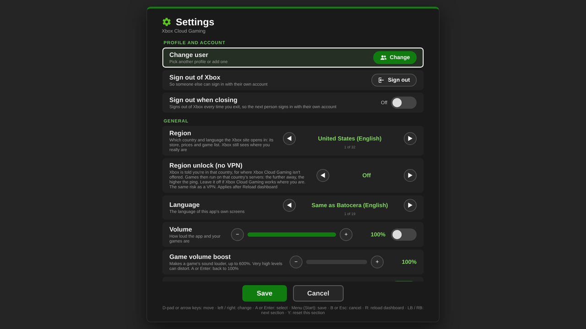
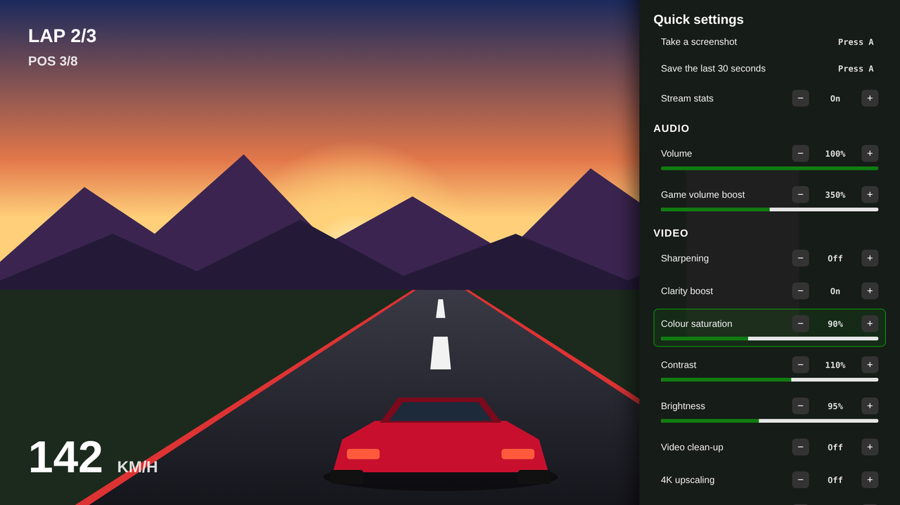

# Xbox Cloud Gaming for Batocera & HippOS

Play **Xbox Cloud Gaming** from the EmulationStation carousel on [Batocera](https://batocera.org) and [HippOS](https://hippos-linux.org). Pick it, and a fullscreen app opens on [play.xbox.com](https://play.xbox.com), ready for your controller. Your cloud games can sit in EmulationStation's list like any other system, with box art, 3D cases and age ratings.

**[⬇ Install](#install)**: one command, always the newest version · also in **BUA** (Batocera Unofficial Add-ons)

> **Unofficial project, use at your own risk.** Not affiliated with, endorsed by or sponsored by Microsoft or Xbox. Xbox, Xbox Cloud Gaming and Xbox Game Pass are trademarks of the Microsoft group of companies.

| Settings | Quick settings in a game |
|---|---|
|  |  |

<sub>The game behind quick settings is a drawn stand-in, not a real game.</sub>

What changed in each version: [CHANGELOG.md](CHANGELOG.md).

## Features

**The app**
- A fullscreen Xbox Cloud Gaming app that works entirely with a controller. It has an on-screen keyboard for signing in and searching, and a number pad for codes.
- It only goes to Microsoft's own sites (Xbox, sign-in, the Microsoft Store and your account). Every other link, popup and download is blocked.
- **Profiles**: each person gets their own Xbox sign-in and all of their own settings. A PIN keeps children's and teens' profiles out of the adults' accounts.
- **Back up and restore** the settings and profiles (not the sign-ins) as one file in the share folder, for a new device or after reinstalling.
- **Safe mode**: if the picture ever goes black or breaks up, hold LB + RB while the app opens; the graphics options turn off so you can start again from there.
- The app's own screens are in 18 languages and follow the system's language by default.

**Stream options** (Settings, saved per profile)
- **Resolution**: 720p, 1080p, 1080p high quality or 1440p. Each shows the internet speed it needs. 1440p requires Game Pass Ultimate and a game that offers it.
- **Picture**: sharpening, Clarity boost, and sliders for contrast, colour saturation and brightness.
- **Stream stats**: resolution, frame rate, ping, bitrate, packet loss and decode time, shown at the top while you play.
- **Controller vibration** strength, and **GPU acceleration** (including hardware video decoding).
- **Game volume boost** up to 600%, **Prefer IPv6 server**, **Microphone on game launch**, and the **wait time** for a server on each game's page.
- **Region unlock without a VPN** (Australia, Brazil, Europe, Japan, Korea, United States) for where Xbox Cloud Gaming isn't offered, and **Disable social features** for a faster dashboard.
- An **on-screen touch controller**: see-through buttons over the game for touch screens.
- **4K upscaling** on 64-bit PCs: the stream drawn at the screen's full resolution and sharpened on the graphics chip (Xbox sends at most 1440p; this uses more of the GPU).
- **Quick settings in a game** (hold LB + RB + View, or F9): sound and picture over the game, stream stats, **screenshots** with the picture settings in them (saved to `/userdata/screenshots`), and **instant replay**: the last 30 seconds as a video in `/userdata/recordings`.
- Games started from the dashboard count in EmulationStation's **play count, last played and play time**.
- **Skip the Xbox splash video**, **turn off post-game feedback**, **reduce animations** and **turn off analytics** for slower devices.
- **Low-power settings** in one press for slower devices, offered once the first time the app opens on an ARM device.

**EmulationStation game list** (optional)
- **All cloud games** (about 570), **Free with ads** (the games anyone can play free with ads, no Game Pass needed), **Games I pick** (add a game with F8 or LB + RB + LT + RT), or **Off** (just the app itself).
- Each game comes with box art, background, logo, description, developer, release date and age rating, all from Microsoft's catalog. Picking a game opens the app straight into it.
- **3D game boxes**: a black case with the cover, the name on the spine, an age-rating tile, and badges for games that support **keyboard and mouse** or **touch**.
- The list updates itself every few days. A progress bar in the bottom-left corner shows how far an update has got, and an update carries on in the background if you close the app.
- Xbox Cloud Gaming itself always stays at the top of the list.

**Split screen** (optional, off by default): 2 to 4 players on one screen. Player 1 uses the first controller; the others press A to join the next box and pick a profile or play as a guest. Each player's selection is in their own colour: green, red, blue, yellow (the A, B, X and Y colours). Guests are forgotten when the app closes unless "Remember split-screen players" is on.

**Launch Single Game** (optional): picking Xbox Cloud Gaming in the carousel opens the app straight away, and closing it takes you back to the carousel.

## What you need

- **Batocera or HippOS** on a 64-bit PC or a Steam Deck (tested), or another PC handheld or ARM device (not fully tested yet; see [Compatibility](#compatibility)).
- **An internet connection**: about 10 Mbps for 720p and 20 Mbps or more for 1080p. Wired or 5 GHz Wi-Fi is best.
- **An Xbox account with a Game Pass plan that includes cloud gaming**, in a country where Xbox Cloud Gaming is offered.
- **About 400 MB free** in `/userdata`, for the browser engine the installer downloads.
- **A controller** (an Xbox controller is best), or a keyboard and mouse.

## Install

Open a terminal on Batocera or HippOS (on Batocera, F1 → Applications → xterm, or SSH in) and run:

```bash
curl -fsSL https://raw.githubusercontent.com/rmach89/xcloud-batocera-hippos/main/install.sh -o /tmp/xcloud-install.sh
bash /tmp/xcloud-install.sh
```

The installer downloads the newest version straight from this repository's main branch, installs it, and tidies up after itself. Answer its questions, then restart EmulationStation. Xbox Cloud Gaming appears in the carousel.

It's also in **BUA** (Batocera Unofficial Add-ons): pick **Xbox Cloud Gaming** there. BUA runs the same installer, so it gets the newest version too, and the installer's questions appear on BUA's screen. On HippOS the installer asks nothing.

Installed from a `git clone` of this repository? Run `bash install.sh` in it. If main has a newer version than your copy, it offers that one instead.

To install a fixed version instead of the newest (for a distribution that wants to pin one), give its tag: `XCLOUD_TAG=v1.3.2 bash /tmp/xcloud-install.sh`. The app's own updates then follow that tag rather than main.

## Updating

- **From the app:** Settings → Help and maintenance → **Updates**. One press checks this repository's main branch for a newer app and Electron for a newer browser engine, and downloads whichever is newer. The new version is installed when you close the app, and your sign-ins, profiles, settings and picked games are kept. If anything fails, nothing changes, and the log says why.
- **Or run the installer again** (the two lines above). It always gets the newest version.

## Controls

| Action | Xbox | PlayStation | Keyboard |
|---|---|---|---|
| Exit back to EmulationStation | hold View + Menu (2 s) | hold Share/Create + Options | hold Esc |
| Welcome screen and Settings | hold Menu (1 s) | hold Options | — |
| Settings on the dashboard | — | — | Backspace |
| Add or remove the current game in EmulationStation's list | hold LB + RB + LT + RT | hold L1 + R1 + L2 + R2 | F8 |
| Open a whole row (its title) on the dashboard | hold View on a game in it (1 s) | hold Share/Create | — |
| Quick settings in a game (sound and picture) | hold LB + RB + View (1 s) | hold L1 + R1 + Share/Create | F9 |
| Screenshot in a game | Quick settings → Take a screenshot | the same | PrintScreen |
| Settings: previous / next section | LB / RB | L1 / R1 | Page Up / Page Down |
| Settings: reset the section you're in | Y twice | △ twice | Y twice |
| Safe mode (graphics options off) | hold LB + RB while the app opens (2 s) | hold L1 + R1 | `Run-App.sh --safe` |

The first few times you move onto a row with the controller, a hint at the bottom shows how to open it ("Hold View to open Stream for free with ads").

In Settings: up and down to move, left and right to change, A to select, Menu to save, B to cancel. A reset only changes the screen; Save keeps it and Cancel undoes it. Region and Language aren't reset. The app's own screens show your controller's buttons: A B X Y on Xbox, ✕ ○ □ △ on PlayStation.

## Settings

| Section | What's in it |
|---|---|
| Profile and account | Change user, sign out of Xbox, sign out when closing |
| General | Region, region unlock (no VPN), language, volume, game volume boost, key highlights, intro video and its sound, low-power settings |
| Stream | Resolution, connection check, stream as a Windows PC, GPU acceleration, prefer IPv6 server, keep stream quality steady, reconnect automatically, stay connected, microphone on game launch, instant replay, stream stats (with 60-second graphs) |
| Picture | Sharpening, 4K upscaling with its size and sharpness (64-bit PCs), video clean-up, Clarity boost, contrast, colour saturation, brightness, settings per game (picture, game volume boost and vibration) |
| Controller | The full list of controls, vibration strength, each controller's own stick dead zone, vibration and A/B X/Y swap, on-screen touch controller, controller battery, split screen (2-4 players), remember split-screen players |
| Xbox dashboard | Disable social features, wait time on game pages, skip Xbox splash video, turn off post-game feedback, reduce animations, turn off analytics |
| EmulationStation | The game list (Off / All cloud games / Free with ads / Games I pick), 3D game boxes |
| Help and maintenance | Reload dashboard, clear cache, save logs for help, back up settings, restore settings, updates |

## Profiles and PIN

The first person to sign in becomes the first profile. When someone else signs in, the app offers to set up profiles. With two or more, **"Who's playing?"** appears when the app opens.

Once a child's or teen's profile exists, the adult profiles need a **4-digit PIN**. The PIN is also needed to add or remove profiles and to uninstall. It's stored only as a salted hash. It only guards this app: Microsoft's own family settings are what control what an account can play or buy.

Forgot the PIN? Create a file named `reset-pin` in `/userdata/system/add-ons/xcloud`. It's cleared the next time the app opens.

## Controllers

- **Xbox and PlayStation controllers** are passed to Xbox as they are; Xbox supports them directly.
- **Steam controllers** (Steam Deck controls, Steam Controller): Xbox doesn't support them, so the app shows them to Xbox as an Xbox controller, with the buttons in Xbox's layout.
- **Other controllers the browser doesn't recognise** are put into the Xbox layout, so the sticks, triggers and D-pad work.

## Compatibility

**Tested:** 64-bit PCs with Batocera v42 and v44, and HippOS 0.5; the Steam Deck, including its built-in controls.

Other devices haven't been fully tested yet. How well they do depends on the processor, because the game stream is video it has to decode. Based on their hardware:

| | Devices |
|---|---|
| ✅ Tested | 64-bit PCs; Steam Deck |
| 🔸 Should play well (not fully tested) | other PC handhelds (ROG Ally, Legion Go); Raspberry Pi 5; RK3588 boards; Snapdragon handhelds (AYN Odin 2, Retroid Pocket 5) |
| ⚠️ May stutter (not tested) | Raspberry Pi 4 (2 GB+); Odroid N2; RK3566 / RK3568 (Anbernic RG353 series); newer Amlogic TV boxes |
| 🐢 Too slow | 1 GB devices (RG35XX family, RG351, Raspberry Pi 3) and 32-bit ARM |
| ❌ Not supported | Raspberry Pi 1 / Zero (ARMv6) and 32-bit x86 PCs; the installer stops without changing anything |

On ARM boards that stutter, try Settings → GPU acceleration. Tried it on one of these? Let us know how it went in an [issue](https://github.com/rmach89/xcloud-batocera-hippos/issues).

## Uninstall

F1 → Applications → **Xbox Cloud Gaming Uninstaller**, or:

```bash
bash /userdata/system/add-ons/xcloud/uninstall.sh
```

It asks before removing anything, and can keep everyone's sign-ins and profiles for a reinstall. When it's done, press Enter to exit; EmulationStation reloads by itself. To remove everything without questions, add `--all`. From BUA, its questions appear on BUA's screen; if a child's profile needs the PIN, use the F1 shortcut instead, since BUA can't take typed answers.

## FAQ

**Is this an official Xbox app?**
No. It's a fan-made add-on that opens Microsoft's own Xbox Cloud Gaming website (play.xbox.com) in a fullscreen window made for controllers. You sign in with your own Microsoft account.

**Do I need Game Pass?**
For most games, yes: a Game Pass plan that includes cloud gaming. The **Free with ads** games play without Game Pass.

**Why is the picture 1080p at most (1440p with Ultimate)? Can it do 4K?**
That's what Xbox sends to browsers. **4K upscaling** (64-bit PCs) draws the stream at your TV's full resolution and sharpens it on the graphics chip. It's sharper, but not real 4K.

**What's the difference between Region and Region unlock?**
**Region** only picks which version of the Xbox site you get (its language, store, prices and game list); Xbox still sees where you really are. **Region unlock** tells Xbox you're in another country, for places where Xbox Cloud Gaming isn't offered. Your games then run on that country's servers, so the further away it is, the higher the ping. Leave it off if Xbox Cloud Gaming works where you are. It carries the same risk as a VPN.

**The picture is black, flickers or breaks up.**
Hold **LB + RB** for two seconds while the app opens (safe mode). It turns off GPU acceleration, 4K upscaling, video clean-up, sharpening and the picture adjustments. Then turn things back on one at a time in Settings to find the one your device doesn't like.

**Games stutter on my ARM board.**
Try Settings → General → **Low-power settings**, a lower **Stream resolution**, and **Connection check** to see what your internet can carry. Wired or 5 GHz Wi-Fi helps the most.

**Does each person keep their own settings?**
Yes. With profiles set up, every setting belongs to the profile, except GPU acceleration, split screen, the EmulationStation game list and the controller layout, which are for the whole machine.

**Can I move my setup to another device?**
Settings → Help and maintenance → **Back up settings** saves one file in the share folder. Copy it to the other device's share folder and use **Restore settings** there. Sign-ins aren't in the backup, so each profile signs in to Xbox once on the new device.

**Will an update lose my sign-ins or settings?**
No. Updating from Settings or running the installer again keeps sign-ins, profiles, settings and picked games.

## License

MIT. See [LICENSE](LICENSE).

## Help

- **Logs** are in `/userdata/system/logs/`:
  - `xcloud-install.log`: install and uninstall
  - `xcloud.log`: each launch
  - `xcloud-app.log`: what happens inside the app
  - `xcloud-update.log`: updates installed from Settings
- **Settings → Save logs for help** puts the logs and your settings into one zip in the share folder, ready to send. Gamertags are replaced, and nothing about sign-ins is included.
- **Full documentation:** `README.txt` in the download covers every setting, the game list, profiles and troubleshooting.
- **Problems and suggestions:** open an [issue](https://github.com/rmach89/xcloud-batocera-hippos/issues/new/choose). The bug report form asks for the "Save logs for help" zip, which is usually all that's needed to find the cause.

## Credits

- The app runs on [Electron](https://github.com/electron/electron) (MIT License), downloaded from Electron's official releases and checked against its published SHA-256 checksums. If the system already has Electron (v30 or newer), the app uses that one and downloads nothing.
- The intro video and sound are original, made for this project.
- Japanese and Korean text uses parts of Noto Sans CJK (SIL Open Font License 1.1). The controller emoji is from Noto Color Emoji (Apache License 2.0).
- Batocera, HippOS and EmulationStation are their own projects; this add-on only adds a system to them.
